<div align="center">


# 🧭 Trip Planer

### Your travel planner for the road – offline, no account, any country

Route, stops, activities, daily plan, budget, and emergency info in one installable web app.


<a href="https://github.com/phil07/Trip_Planer/actions/workflows/test.yml"></a>

[Deutsch](README.md) · **English**

[Features](#-features) · [Quick start](#-quick-start) · [Project structure](#-project-structure) · [Deployment](#-deployment) · [Privacy](#-privacy-and-backup)

<br/>

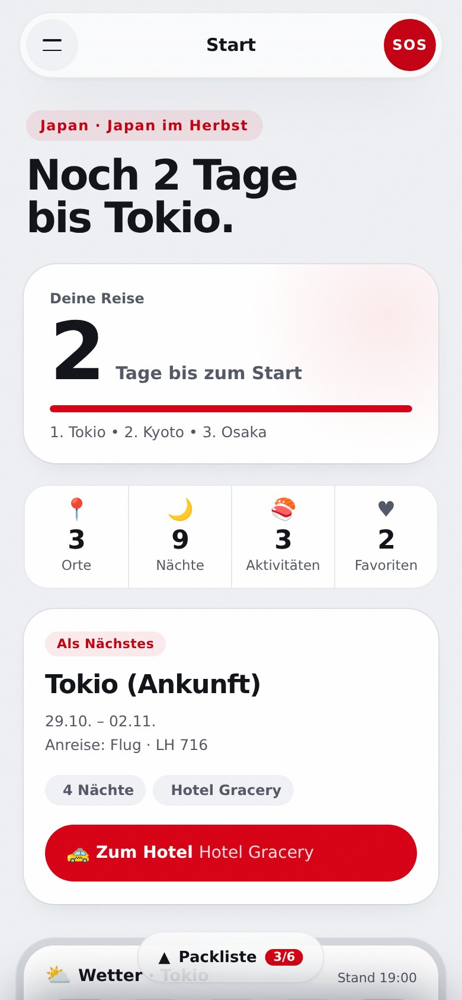
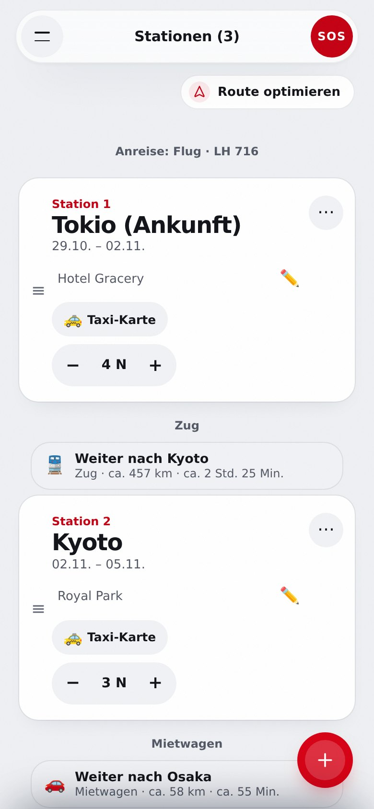
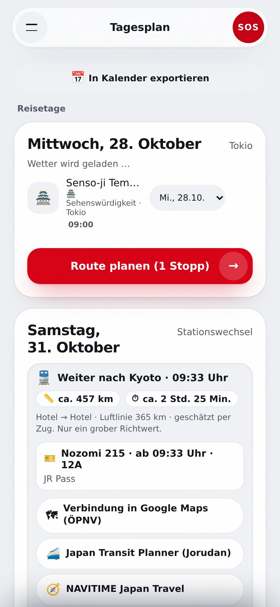
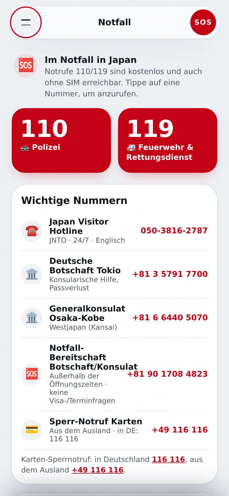

</div>

<br/>

## 🌍 Why Trip Planer?

Built for a trip to Japan, Trip Planer now works for **any destination**: language, currency, emergency numbers, and route suggestions follow the selected country. Everything runs in the browser – no sign-up, no build step. Trips are stored locally; syncing with your own Google Drive is optional. Once loaded, the app stays available without internet.

| | |
| --- | --- |
| 📴 **Offline first** | Service worker and local storage: plan, phrase guide, and emergency info work in airplane mode |
| 🔒 **Your data stays with you** | Stored locally in the browser. Optional sync only in the hidden app folder of your Google Drive – no server of the developer. JSON export and import |
| 🌐 **Any country** | Phrase guide, currency, emergency numbers, and routes adapt to the destination |
| ⚡ **No build** | Plain HTML, CSS, and JavaScript – a static server is enough |

## ✨ Features

| Feature | Description |
| --- | --- |
| **Route & stops** | Stops with nights and lodging, connections with distance and duration per transport mode, map view |
| **Daily plan** | Activities and restaurants per stop, times, weather, calendar export (`.ics`) |
| **AI route assistant** | Route suggestions and optimization to your wishes |
| **SOS page** | Emergency numbers of the destination, phrases to show, personal emergency card |
| **Phrase guide & taxi card** | Key phrases and destination address in large local script |
| **Budget** | Track expenses, split among travelers, currency converter |
| **Journal & packing lists** | Entries with photos, multiple packing lists |
| **Multiple trips** | Create, switch and delete any number of trips; the share link shows the active trip |
| **Google Drive sync (optional)** | Back up trips to the app folder of your Google account and load them on other devices. Simultaneous changes are detected, nothing is overwritten silently |
| **Export & import** | All data stays local, JSON backup |

<details open>
<summary><b>All menu items at a glance</b></summary>

The menu lists all views one below another, followed by the buttons for sharing, trips, backup, restore and cloud. Views in menu order: Home, Map, Stops, Activities, Daily plan, Currency converter, Trip costs, Phrase guide, Documents, Journal, Emergency.

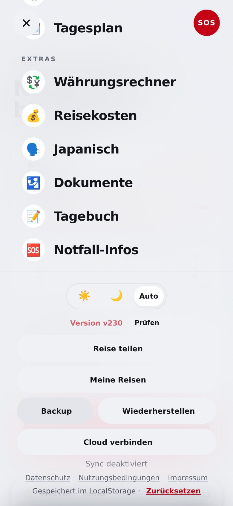


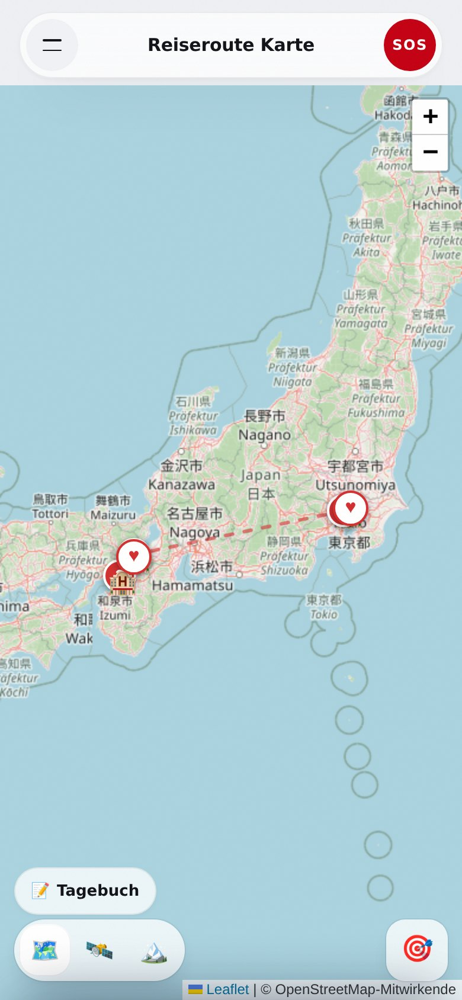

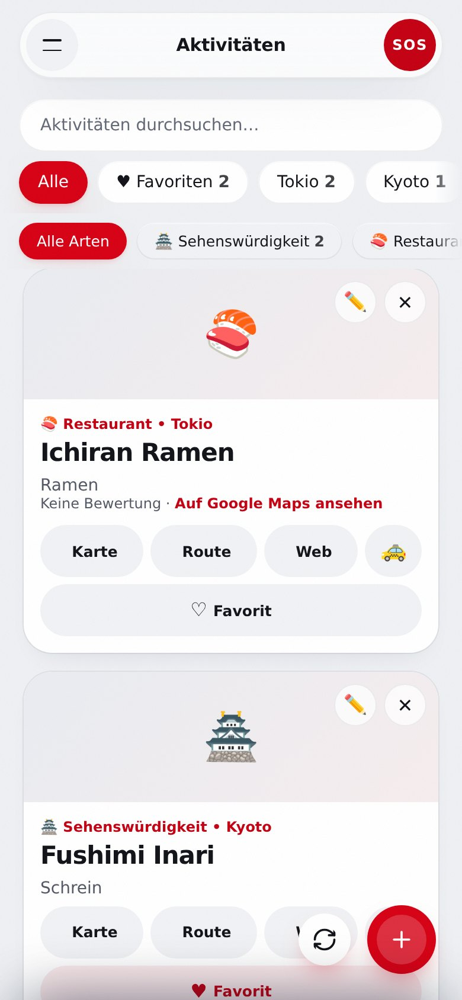

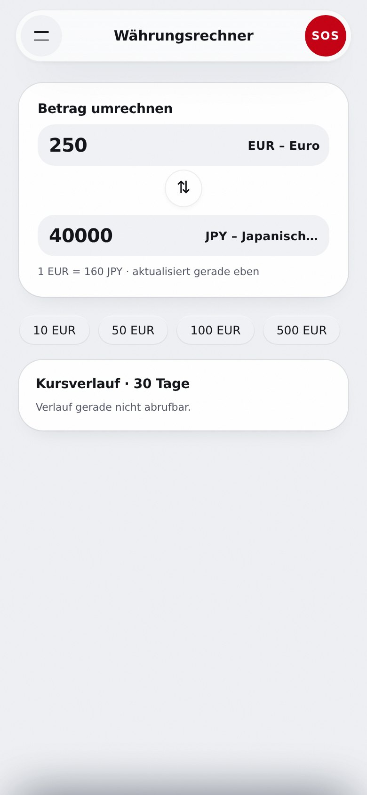
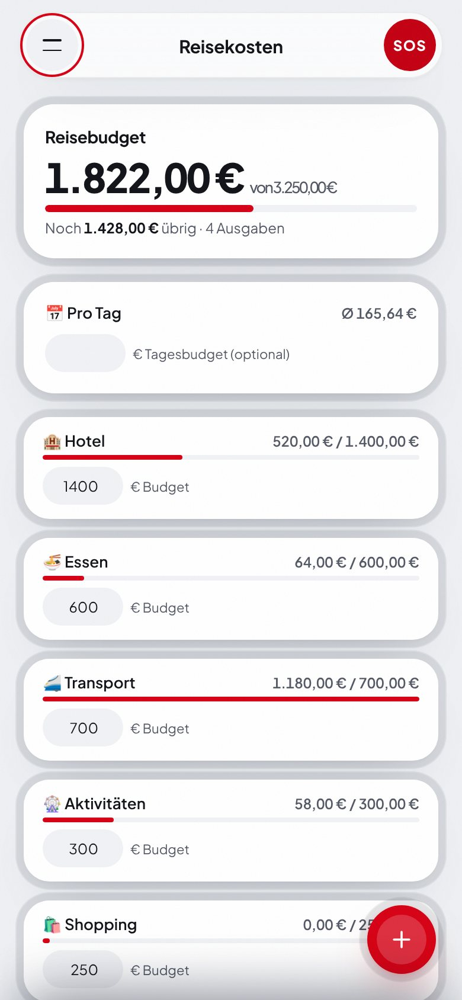
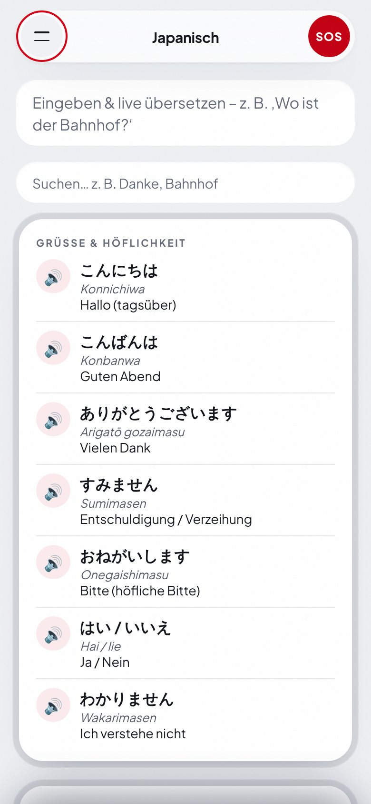
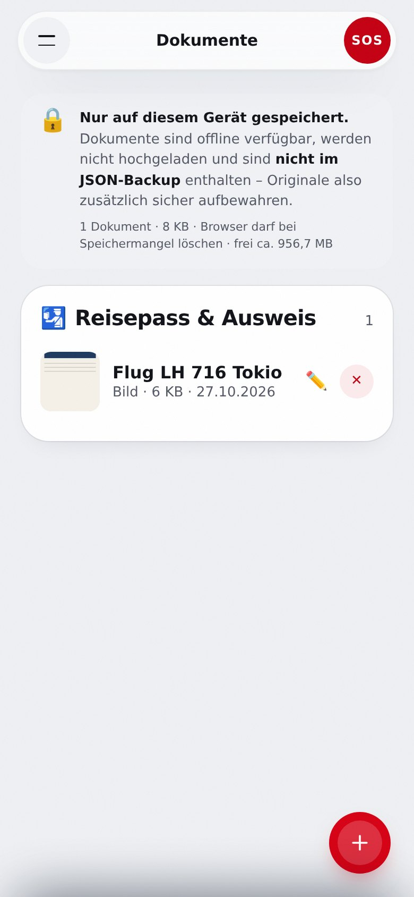
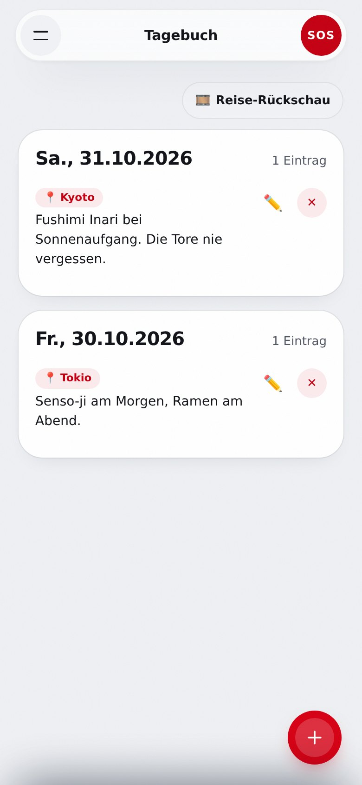


</details>

## 🚀 Quick start

No dependencies, no build. Serve the app folder with a local HTTP server:

```bash
python -m http.server --directory Trip-Planer 8080
```

Then open `http://localhost:8080`. Service workers and PWA installation require HTTP(S) – `file://` is not enough.

**Install as an app:** use *Install* or *Add to Home Screen* in the browser menu. After the first load, the core features work offline.

## 🧱 Project structure

| Path | Contents |
| --- | --- |
| `Trip-Planer/` | The app: `index.html`, `app.js`, `style.css`, `sw.js`, `manifest.json`, `version.js` |
| `Trip-Planer/features/` | Feature modules (weather, emergency, taxi card, cost splitting, calendar, reminders …) |
| `Trip-Planer/sync.js` | Optional sync via Google Drive (scope `drive.appdata`) |
| `Trip-Planer/datenschutz.html`, `nutzungsbedingungen.html`, `impressum.html` | Legal pages (German), in app design |
| `worker/` | Cloudflare Worker, prepared for web push ([setup](docs/push-setup.md), German) |
| `puter_bridge/` | Separate worker for the additional AI source, isolated from the app ([README](puter_bridge/README.md)) |
| `tests/` | Node tests (calendar, cost splitting, data storage, data normalization, connections, emergency, opening hours, weather, reminders, sharing, home screen) |
| `wrangler.jsonc` | Deployment of the app as static Cloudflare assets |

## ☁️ Deployment

The app is served as static assets through Cloudflare Workers:

```bash
npx wrangler deploy
```

The build uses the `Trip-Planer/` directory (see `wrangler.jsonc`). Security headers are defined in `Trip-Planer/_headers`.

## 🧪 Tests

```bash
node --test tests/*.test.mjs   # unit tests (fast, no browser)

npm install                    # once: playwright-core
npm run test:e2e               # browser tests against the real app (needs Chromium)
```

The browser tests start a local server, stub the network, and cover menu, stops, daily plan, currency converter, country change with SOS, packing list, and settings. Without Chromium (`CHROME_PATH` or `/opt/pw-browsers`) they are skipped.

## 🔌 External services

The app needs no servers of its own. For current content it calls public services on demand:

| Purpose | Service |
| --- | --- |
| Places and maps | OpenStreetMap/Nominatim, Esri (satellite map), OpenTripMap, Mapbox, Geoapify, Yelp Fusion, Google Places |
| Photos | Wikimedia Commons |
| Weather | Open-Meteo |
| Exchange rates | Frankfurter |
| Phrase-guide translation | Google Translate |
| AI routes | Pollinations, Puter (via its own bridge, see `puter_bridge/`) |
| Optional sync | Google Drive (only with your sign-in) |

Each service's own privacy terms apply. Without a connection, stored data and already loaded content remain usable.

## 🔐 Privacy and backup

Trip data stays in the browser's local storage. If you turn on Google Drive sync, a file is additionally stored in the hidden app folder of your Google account; no server of the developer has access to it. Clearing browser data or resetting the device removes the local data. The installed app and a browser tab may use separate storage. **Export your trip regularly** (menu → settings) and treat export files like personal travel documents.

> Emergency numbers and phrases are provided without warranty; when in doubt, use the local emergency number.
