<div align="center">


# 🧭 Trip Planer

### Dein Reiseplaner für unterwegs – offline, ohne Konto, für jedes Land

Route, Stationen, Aktivitäten, Tagesplan, Budget und Notfall-Infos in einer installierbaren Web-App.


<a href="https://github.com/phil07/Trip_Planer/actions/workflows/test.yml"></a>

**Deutsch** · [English](README.en.md)

[Funktionen](#-funktionen) · [Schnellstart](#-schnellstart) · [Projektstruktur](#-projektstruktur) · [Deployment](#-deployment) · [Datenschutz](#-datenschutz-und-sicherung)

<br/>

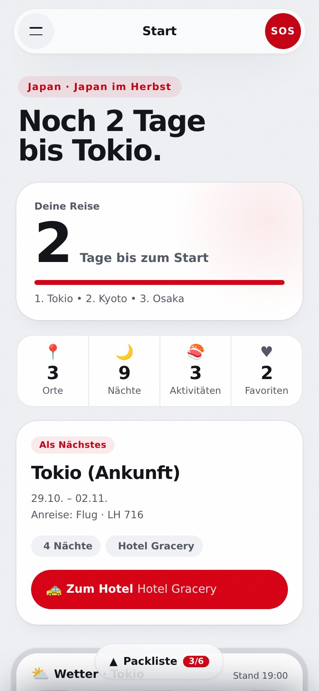
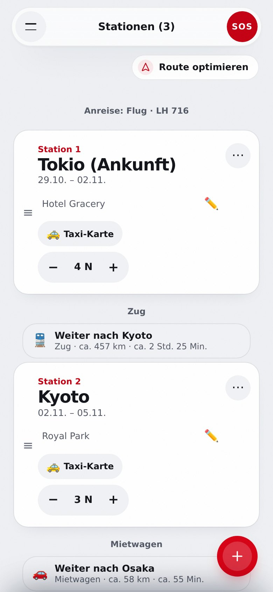
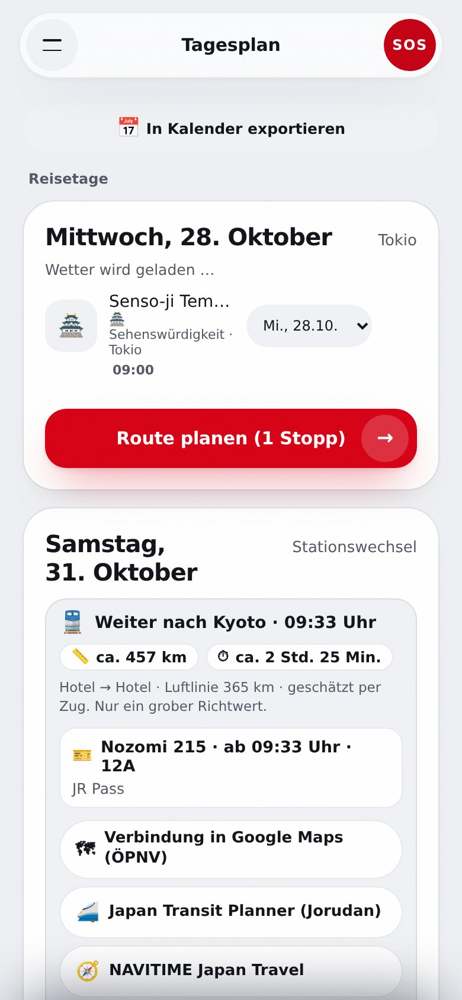
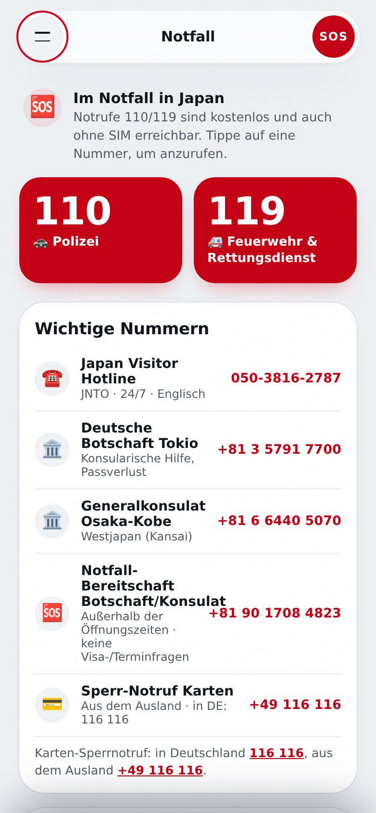

</div>

<br/>

## 🌍 Warum Trip Planer?

Entstanden für eine Japan-Reise, funktioniert Trip Planer inzwischen für **jedes Reiseland**: Sprache, Währung, Notrufnummern und Routenvorschläge folgen dem gewählten Land. Alles läuft im Browser – keine Registrierung, kein Build-Schritt. Die Reise liegt lokal; ein Abgleich über den eigenen Google Drive ist optional. Einmal geladen, steht die App auch ohne Internet zur Verfügung.

| | |
| --- | --- |
| 📴 **Offline zuerst** | Service Worker und lokale Speicherung: Plan, Sprachführer und Notfall-Infos funktionieren im Flugmodus |
| 🔒 **Deine Daten bleiben bei dir** | Lokal im Browser. Optionaler Abgleich nur im versteckten App-Ordner deines Google Drive – kein Server des Entwicklers. Export und Import als JSON |
| 🌐 **Für jedes Land** | Sprachführer, Währung, Notrufnummern und Routen passen sich dem Reiseland an |
| ⚡ **Ohne Build** | Reines HTML, CSS und JavaScript – ein statischer Server genügt |

## ✨ Funktionen

| Funktion | Beschreibung |
| --- | --- |
| **Route & Stationen** | Stationen mit Nächten und Unterkunft, Verbindungen mit Strecke und Dauer je Transportmittel, Kartenansicht |
| **Tagesplan** | Aktivitäten und Restaurants je Station, Uhrzeiten, Wetter, Kalenderexport (`.ics`) |
| **KI-Routen-Assistent** | Routenvorschläge und Optimierung nach deinen Wünschen |
| **SOS-Seite** | Notrufnummern des Reiselandes, Notfall-Sätze zum Zeigen, persönlicher Notfall-Ausweis |
| **Sprachführer & Taxi-Karte** | Wichtige Sätze und Zieladresse groß in der Landessprache |
| **Budget** | Ausgaben erfassen, auf Mitreisende aufteilen, Währungsrechner |
| **Tagebuch & Packlisten** | Einträge mit Fotos, mehrere Packlisten |
| **Mehrere Reisen** | Beliebig viele Reisen anlegen, wechseln und einzeln löschen; der Teilen-Link zeigt die aktive Reise |
| **Google-Drive-Abgleich (optional)** | Reisen im App-Ordner deines Google-Kontos sichern und auf anderen Geräten laden. Gleichzeitige Änderungen werden erkannt, nichts wird stillschweigend überschrieben |
| **Export & Import** | Alle Daten lokal, Sicherung als JSON |

<details open>
<summary><b>Alle Menüpunkte im Überblick</b></summary>

Das Menü zeigt alle Ansichten untereinander, darunter die Knöpfe für Teilen, Reisen, Backup, Wiederherstellen und Cloud. Reihenfolge der Ansichten wie im Menü: Start, Karte, Stationen, Aktivitäten, Tagesplan, Währungsrechner, Reisekosten, Sprachführer, Dokumente, Tagebuch, Notfall.

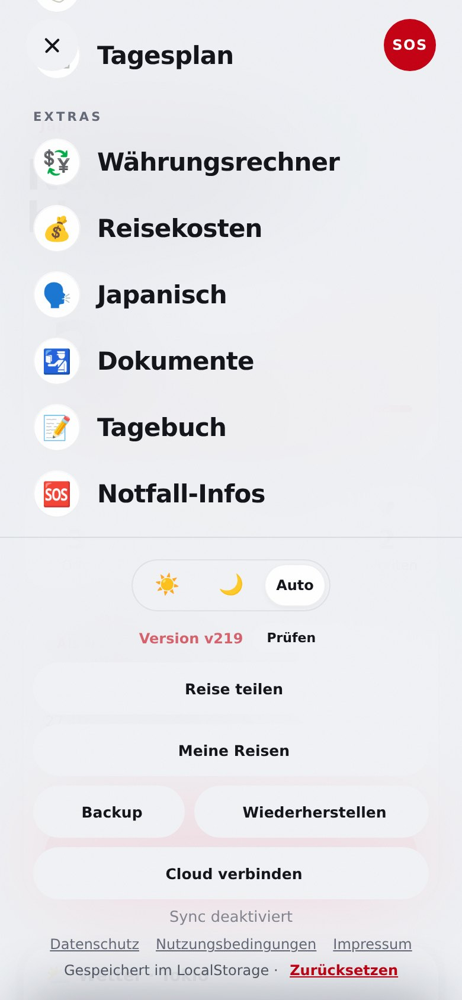


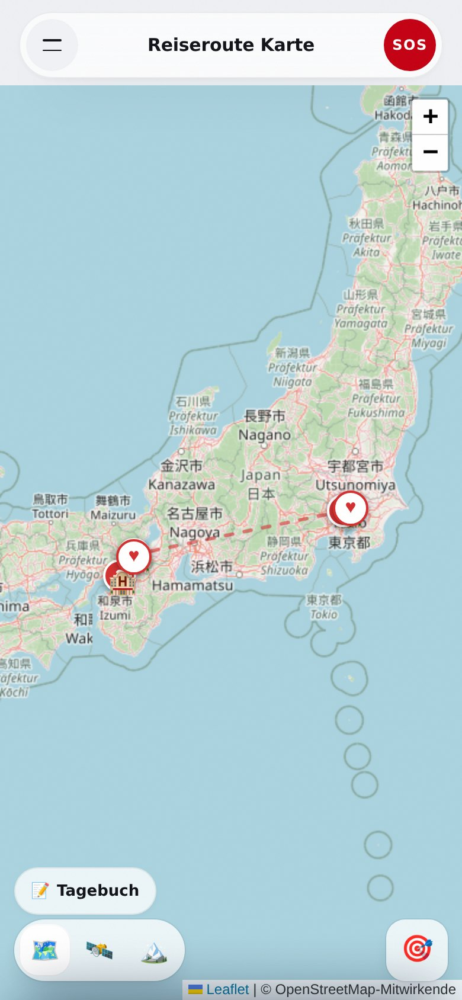

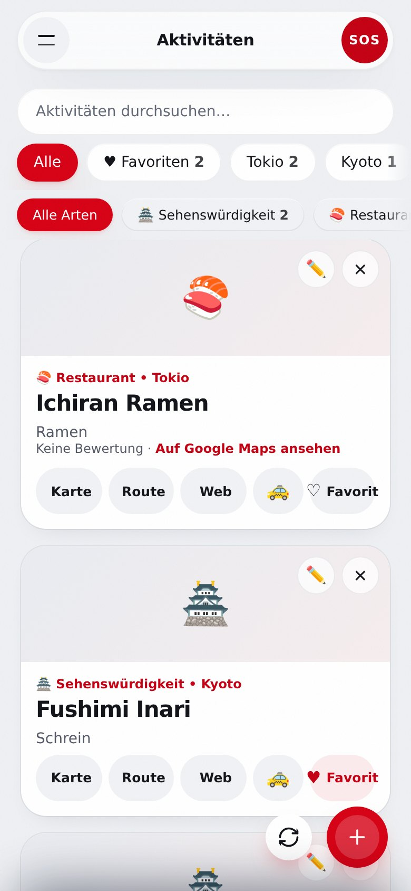

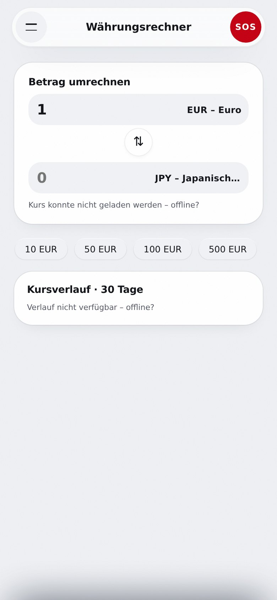
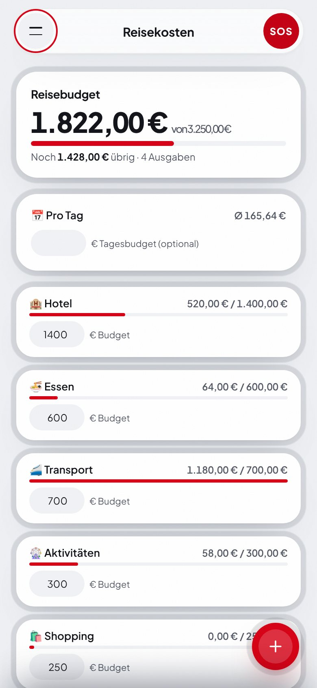
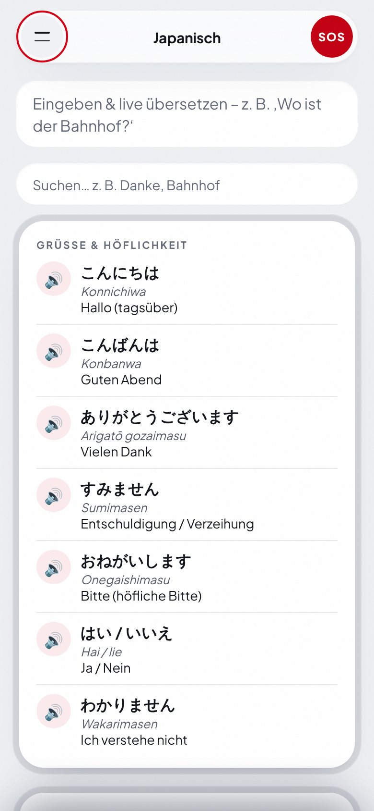
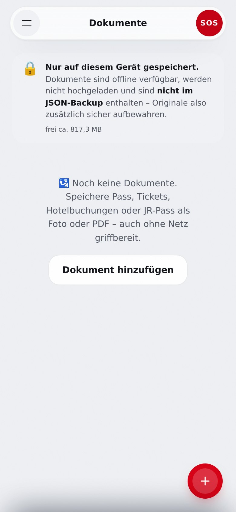
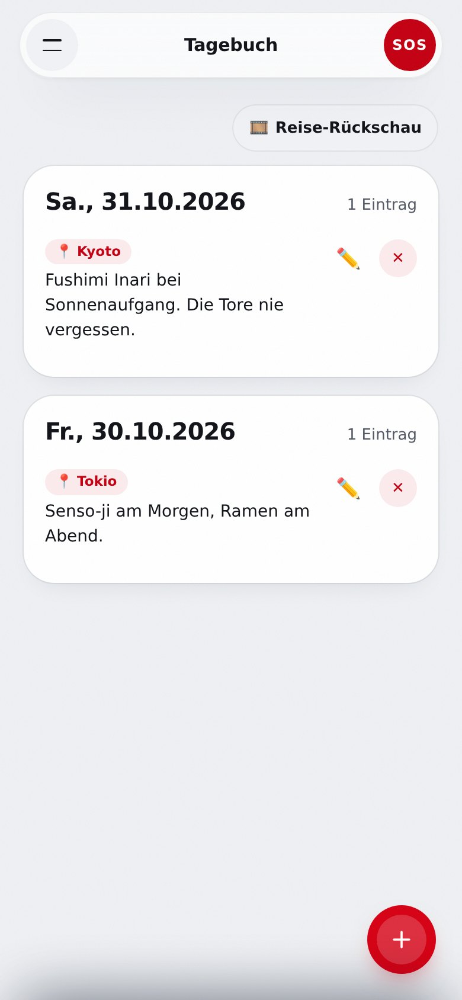


</details>

## 🚀 Schnellstart

Keine Abhängigkeiten, kein Build. Den App-Ordner über einen lokalen HTTP-Server ausliefern:

```bash
python -m http.server --directory Trip-Planer 8080
```

Anschließend `http://localhost:8080` öffnen. Service Worker und PWA-Installation benötigen HTTP(S) – `file://` genügt nicht.

**Als App installieren:** im Browser-Menü *Installieren* bzw. *Zum Startbildschirm hinzufügen* wählen. Nach dem ersten Laden stehen die Grundfunktionen offline zur Verfügung.

## 🧱 Projektstruktur

| Pfad | Inhalt |
| --- | --- |
| `Trip-Planer/` | Die App: `index.html`, `app.js`, `style.css`, `sw.js`, `manifest.json`, `version.js` |
| `Trip-Planer/features/` | Funktionsmodule (Wetter, Notfall, Taxi-Karte, Kostenaufteilung, Kalender, Erinnerungen …) |
| `Trip-Planer/sync.js` | Optionaler Abgleich über Google Drive (Scope `drive.appdata`) |
| `Trip-Planer/datenschutz.html`, `nutzungsbedingungen.html`, `impressum.html` | Rechtliche Seiten, im App-Design |
| `worker/` | Cloudflare-Worker: verschlüsselte Kurzlinks fürs Teilen (`/api/share`, KV wird beim Deploy automatisch angelegt) und vorbereitet Web-Push ([Einrichtung](docs/push-setup.md)) |
| `puter_bridge/` | Eigener Worker für die zusätzliche KI-Quelle, getrennt von der App ([README](puter_bridge/README.md)) |
| `tests/` | Node-Tests (Kalender, Kostenaufteilung, Datenspeicherung, Datenaufbereitung, Verbindungen, Notfall, Öffnungszeiten, Wetter, Erinnerungen, Teilen, Startseite) |
| `wrangler.jsonc` | Deployment der App als statische Cloudflare-Assets |

## ☁️ Deployment

Die App wird als statische Assets über Cloudflare Workers ausgeliefert:

```bash
npx wrangler deploy
```

Der Build verwendet das Verzeichnis `Trip-Planer/` (siehe `wrangler.jsonc`). Die Sicherheits-Header stehen in `Trip-Planer/_headers`.

## 🧪 Tests

```bash
node --test tests/*.test.mjs   # Unit-Tests (schnell, ohne Browser)

npm install                    # einmalig: playwright-core
npm run test:e2e               # Browser-Tests gegen die echte App (Chromium nötig)
```

Die Browser-Tests starten einen lokalen Server, stubben das Netzwerk und prüfen u. a. Menü, Stationen, Tagesplan, Währungsrechner, Länderwechsel mit SOS, Packliste und Einstellungen. Ohne Chromium (`CHROME_PATH` oder `/opt/pw-browsers`) werden sie übersprungen.

## 🔌 Externe Dienste

Die App kommt ohne eigene Server aus. Für aktuelle Inhalte ruft sie bei Bedarf öffentliche Dienste auf:

| Zweck | Dienst |
| --- | --- |
| Orte und Karten | OpenStreetMap/Nominatim, Esri (Satellitenkarte), OpenTripMap, Mapbox, Geoapify, Yelp Fusion, Google Places |
| Fotos | Wikimedia Commons |
| Wetter | Open-Meteo |
| Wechselkurse | Frankfurter |
| Übersetzung des Sprachführers | Google Translate |
| KI-Routen | Pollinations, Puter (über eine eigene Brücke, siehe `puter_bridge/`) |
| Optionaler Abgleich | Google Drive (nur mit deiner Anmeldung) |

Es gelten die jeweiligen Datenschutzregeln der Dienste. Ohne Verbindung bleiben gespeicherte Daten und bereits geladene Inhalte nutzbar.

## 🔐 Datenschutz und Sicherung

Reisedaten verbleiben im lokalen Speicher des Browsers. Wenn du den Google-Drive-Abgleich einschaltest, wird zusätzlich eine Datei im versteckten App-Ordner deines Google-Kontos gespeichert; es gibt keinen Server des Entwicklers mit Zugriff darauf. Das Löschen von Browserdaten oder das Zurücksetzen des Geräts entfernt die lokalen Daten. Installierte App und Browser-Tab können getrennte Speicher haben. **Exportiere die Reise deshalb regelmäßig** (Menü → Daten → Backup) und behandle Exportdateien wie persönliche Reisedokumente.

> Notrufnummern und Notfall-Sätze sind ohne Gewähr; im Zweifel gilt der lokale Notruf.

## 🤝 Mitarbeiten

- Nur der Branch `main` existiert; direkt dorthin committen, keine Pull Requests.
- Bei jedem Push, der etwas unter `Trip-Planer/` ändert, `APP_VERSION` in `Trip-Planer/version.js` um eins erhöhen. Der Service-Worker-Cache leitet sich davon ab, und die App zeigt die Version im Menü.
